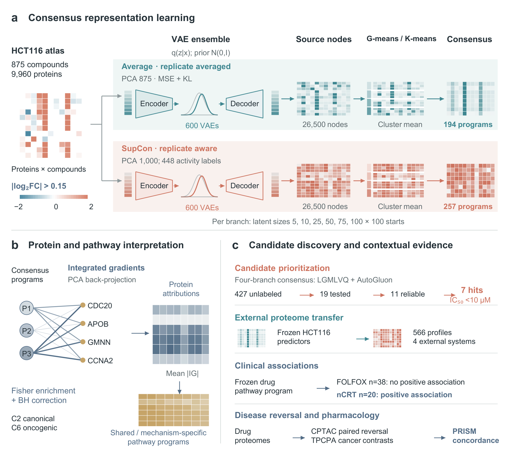

# DeepHeal

Code for **DeepHeal: An interpretable proteomics-first framework for computational drug repurposing**.

DeepHeal learns protein response programs from a public HCT116 perturbation atlas. The Average branch constructs a label-independent VAE ensemble; the SupCon branch incorporates known antineoplastic labels. The workflows connect consensus embeddings, protein attribution, pathway analysis, candidate prioritization, external transfer and exploratory patient analyses.



**DeepHeal workflow.** Overview of the framework and its interpretation and validation workflows (Figure 1 of the accompanying manuscript).

## Organization

Analysis entry scripts are grouped by research task. Their reusable implementations are in `src/deepheal`. Original data, model banks and generated figures are separate from the source code; input requirements are documented in data/README.md.

| Directory under scripts | Workflow |
| --- | --- |
| `model_training` | Average and SupCon VAE ensembles and consensus construction |
| `classification` | LGMLVQ and AutoGluon classifiers in both embedding spaces |
| `benchmarking` | Matched-cohort feature-space and classifier-model comparisons |
| `pathway_analysis` | Integrated gradients, Fisher enrichment, matched-dimensionality comparisons, commonality and response programs |
| `candidate_prioritization` | Four-model consensus evidence for initially unlabeled compounds |
| `external_validation` | ProTargetMiner, MCF7, Jurkat, lung cell lines and frozen 18-profile HepG2 inference |
| `experimental_validation` | CCK8 dose-response fitting and combined experimental summaries |
| `clinical_analysis` | Public processed-input retrieval and prespecified treatment-response analysis |
| `drug_repurposing` | Frozen disease-profile encoding, reversal ranking and independent PRISM evaluation |

## Getting the code

The article repository is https://github.com/DeepHeal/deepheal-study. The same research source tree is supplied with the manuscript.

```bash
git clone https://github.com/DeepHeal/deepheal-study.git
cd deepheal-study
```

## Environment

Use Python 3.11 for the neural and AutoGluon workflows. Install the direct dependencies in `requirements.txt` in an isolated environment. The saved predictors require AutoGluon 1.5.0 and the corresponding model dependencies. LGMLVQ requires ProtoTorch and PyTorch Lightning; a separate environment can be used for it. GPU-enabled PyTorch is recommended for the full model banks. Dependency solving and complete training were not repeated during preparation of this code package.

```bash
python -m pip install -r requirements.txt
```

The standalone R workflows use R 4.5.1. Their direct package list is in `environment/r-packages.R`. Run each R script independently from the article root, or set `DEEPHEAL_ROOT` to that root. Each script explicitly loads its own packages and does not source another analysis script.

## Inputs and execution

See `data/README.md` for input schemas and required model artifacts. Preserve source protein and compound identifiers. Place HCT116 inputs in `data/raw`, pathway GMT files in `data/pathways/gmt_cache`, and supplied frozen branch artifacts in `results/average` and `results/supcon`. Each training entry point exposes its own arguments; a full-project automatic runner is not required.

Examples from the article root:

```bash
python scripts/model_training/train_average_ensemble.py --root . --results-subdir results/average
python scripts/model_training/train_supcon_ensemble.py --root . --results-subdir results/supcon
python scripts/classification/classify_average_autogluon.py --root . --results-subdir results/average
python scripts/classification/classify_supcon_autogluon.py --root . --results-subdir results/supcon
python scripts/pathway_analysis/build_matched_comparators.py --dims 194 257
python scripts/benchmarking/compare_feature_spaces.py --root .
```

Model-bank training uses six latent dimensions (5, 10, 25, 50, 75 and 100), 100 runs per dimension, fixed seeds and the retained hyperparameter-selection recipes. Fresh training can produce a different consensus dimension; the manuscript's 194-dimensional Average and 257-dimensional SupCon results refer to the supplied frozen artifacts. Exact inference requires their saved PCA transforms, source-node memberships, checkpoints and classifier feature order. The SupCon within-cohort analysis is transductive and exploratory because labels contribute to representation learning.

## Public HepG2 processed data

The 18-profile processed release is available at https://doi.org/10.5281/zenodo.23399715 (version 1.0.0, CC BY 4.0). After downloading its files into one folder, verify them and recompute recovery without training:

```bash
python scripts/external_validation/verify_hepg2_processed_data.py --release-dir /path/to/downloaded/files
```

The expected shapes are 18 by 9,960 aligned proteins, 18 by 194 Average coordinates, 18 by 257 SupCon coordinates and 36 prediction rows. Recovery is 14/18 and 15/18 in an assumed-positive panel; it does not estimate specificity. Full frozen inference is `scripts/external_validation/predict_hepg2_frozen.py` and requires the checkpoint and predictor artifacts listed in `data/README.md`. Raw HepG2 mass-spectrometry data: PRIDE accession PXD085749. The raw files are separate from this processed release.

## Verification and scope

Source syntax, local imports, model inference/gradient checks and the public processed-data verification are recorded in `VALIDATION.md`. Random seeds retain their scientific values, including seeds that resemble calendar dates. File and directory names use research tasks rather than run dates. This repository supplies the article's research code; it does not bundle the full data tree, 1,200 checkpoints or AutoGluon predictor directories, and is not a standalone numerical reproduction archive. Outputs from network resources can change; use the archived source inputs for exact figure reproduction.

## License and citation

The project retains the MIT license in LICENSE.md. Third-party notices are retained in THIRD_PARTY_NOTICES.md. Citation metadata for this research software is provided in CITATION.cff; the manuscript has not been assigned a publication DOI.
